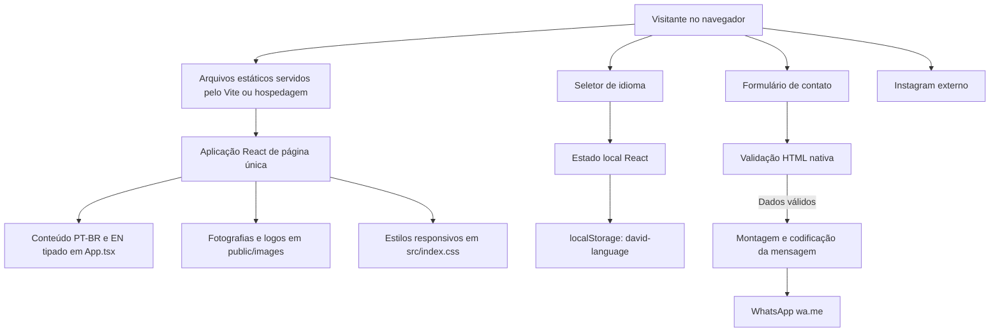

# David Moreira — site de apresentação

Site institucional de página única para apresentar a trajetória, as conquistas e os programas de treinamento de David Moreira, professor de Jiu-Jitsu, Wrestling, Luta Livre e Judô em Manaus.

## Tecnologias

| Tecnologia | Uso no projeto |
| --- | --- |
| React 19 | Interface dividida em seções e elementos reutilizáveis, com estado local para idioma e menu mobile. |
| TypeScript 6 | Tipagem do código React e verificação estática durante o build. |
| Vite 8 | Servidor de desenvolvimento e empacotamento otimizado para publicação estática. |
| CSS | Estilos próprios, tokens visuais, layouts responsivos, animações e suporte a movimento reduzido. |
| lucide-react | Ícones vetoriais da interface. |
| Google Fonts | Tipografia Oswald para títulos e Inter para textos corridos. |

O projeto não utiliza framework adicional de componentes, biblioteca de formulários, serviço de tradução ou CSS-in-JS. O formulário usa validação HTML nativa.

## Desenho do sistema



### Componentes e responsabilidades

- **Entrada:** `src/main.tsx` carrega os estilos e renderiza a aplicação React.
- **Interface e conteúdo:** `src/App.tsx` contém as seções da página, os textos em português e inglês, a navegação, o formulário e as ações de contato.
- **Estilo:** `src/index.css` define o tema escuro, a tipografia, os componentes visuais e os breakpoints para telas menores.
- **Imagens:** `public/images/` contém as fotos e os logos usados pela página. Os caminhos são servidos diretamente a partir da raiz do site.
- **Configuração:** `vite.config.ts`, `tsconfig.json` e os arquivos `tsconfig.*.json` configuram o servidor, o empacotamento e a compilação TypeScript.
- **Documento HTML:** `index.html` define idioma inicial, metadados, fontes e o ponto de entrada da aplicação.

### Fluxos principais

**Navegação:** os links do cabeçalho e do rodapé apontam para IDs de seções na mesma página. Em telas pequenas, o botão do menu abre a navegação móvel; ao selecionar uma seção, o menu fecha.

**Idioma:** os textos estão organizados em `content` dentro de `src/App.tsx`. A escolha entre português e inglês atualiza o estado React, define o atributo `lang` do documento e é persistida em `localStorage`. Na primeira visita, o idioma padrão é português.

**Contato:** os campos de nome, telefone e mensagem são obrigatórios; o e-mail é opcional. Depois da validação do navegador, o site monta a mensagem, codifica os caracteres para URL e abre `https://wa.me/` com o número configurado em `src/App.tsx`. O site não envia dados para um servidor nem os armazena. Os links de contato também direcionam ao WhatsApp e ao Instagram.

## Estrutura de pastas

```text
Davidpage/
├── public/
│   └── images/
│       ├── david-black-gracie.jpg
│       ├── david-black-portrait.jpg
│       ├── david-white-gracie.jpg
│       ├── david-white-wrestling.jpg
│       ├── logo-bjj.jpeg
│       └── logo-wrestling.jpeg
├── src/
│   ├── App.tsx
│   ├── index.css
│   └── main.tsx
├── index.html
├── package.json
├── tsconfig.json
└── vite.config.ts
```

## Desenvolvimento

Requisitos: Node.js compatível com Vite 8 e npm.

```powershell
npm install
npm run dev
```

O servidor de desenvolvimento informa o endereço local no terminal.

### Comandos disponíveis

| Comando | Descrição |
| --- | --- |
| `npm run dev` | Inicia o servidor local de desenvolvimento. |
| `npm run build` | Executa as verificações TypeScript e gera a versão de produção em `dist/`. |
| `npm run preview` | Serve localmente a versão de produção já compilada. |

## Build e publicação

Execute `npm run build` e publique o conteúdo gerado em `dist/` em uma hospedagem de arquivos estáticos, como GitHub Pages, Netlify, Vercel ou Cloudflare Pages. A página não depende de servidor de aplicação ou banco de dados. Configure a hospedagem para servir `index.html` na rota raiz.

## Responsividade e acessibilidade

- O layout se adapta a desktop e dispositivos móveis, com navegação móvel e galerias reorganizadas para telas estreitas.
- As seções têm IDs para navegação por âncoras e espaçamento para o cabeçalho fixo.
- Imagens de conteúdo possuem textos alternativos; imagens decorativas usam alternativas vazias.
- Os controles do menu e do idioma têm rótulos acessíveis.
- A animação contínua da faixa de credenciais respeita a preferência do sistema por movimento reduzido.

## Limites atuais

- Não há backend, banco de dados, painel administrativo, analytics ou envio de e-mail.
- A abertura do WhatsApp depende de o usuário ter acesso ao serviço e confirmar o envio da mensagem.
- Os conteúdos e as traduções são mantidos no código de `src/App.tsx`; para alterar textos, imagens ou informações de contato, atualize esse arquivo e, para imagens, `public/images/`.
- O endereço e os links sociais são informações públicas da página. O formulário não persiste os dados preenchidos.
